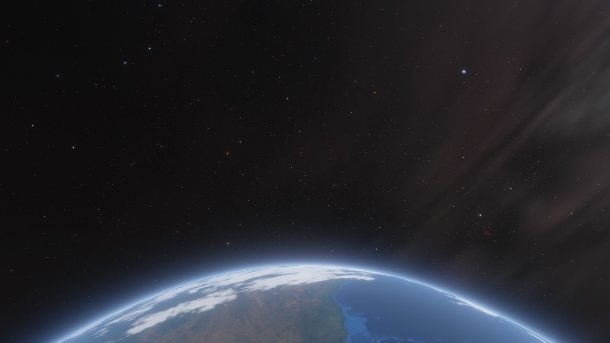
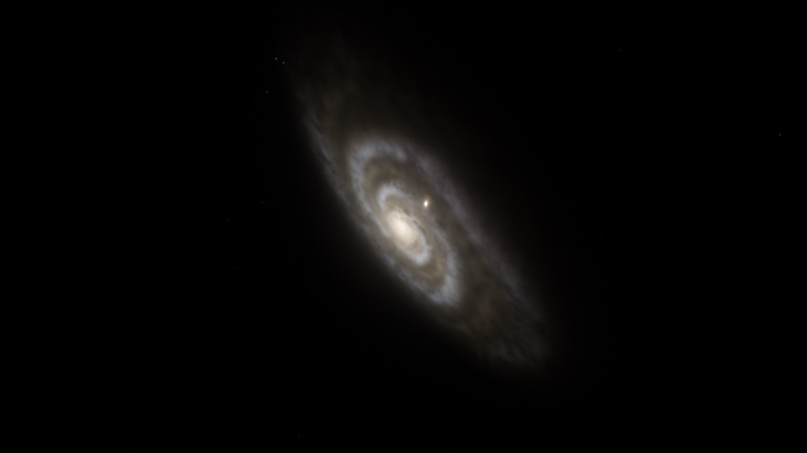

# Starhopper

**The universe, as code.** A real-time flight through the universe as we have actually mapped it, in your browser: from low Earth orbit, out past the planets, through 2.5 million real stars, and on to the galaxies of the cosmic web.



| | |
|---|---|
|  |  |

Rendered with WebGPU and no engine. Everything on screen is either a public catalogue or a documented procedural model; the one image is NASA's Blue Marble on the Earth. The brief it was built from is in [`prompt.txt`](prompt.txt).

## Flying

| | |
|---|---|
| `W A S D`, mouse | fly and look (click the view to capture the mouse) |
| `R` / `F`, `Q` / `E` | up / down, roll |
| wheel, `Shift`, `Ctrl` | speed: exponential, and it follows how close things are |
| click, then `G` | target what you are looking at, then fly to it |
| `1` to `8`, `Home` | the fixed viewpoints, back to Earth |
| `L` `N` `X` | constellation figures, names, stars with known planets |
| `P` | hide all procedural fill: measured data only |
| `M`, `H`, `Tab`, `Esc` | sound, frame statistics, hide the panel, menu |

On a phone or tablet: slide one finger to steer and fly; with two fingers, twist to roll and drag up or down (or pinch) for speed; tap to target, double tap to fly there, and hold on something for a small go-to menu. The menu has search, the viewpoints, named save points (kept in your browser), the detail level and the data credits.

## What is real and what is filled in

Measured, from catalogues pinned by checksum:

- **Stars**: AT-HYG 4.0, 2.53 million stars with distances (Hipparcos, Tycho-2, Gaia), magnitudes and colours.
- **Constellations and star names**: Stellarium's modern sky culture. The figures are drawn between the stars' real 3D positions, so they distort as you leave the Sun.
- **Sun and planets**: JPL's approximate Keplerian elements, at today's date.
- **Nebulae and clusters**: OpenNGC, with distances from Harris (globulars), Hunt & Reffert (Gaia clusters), Gaia-based planetary nebula and supernova remnant catalogues, molecular cloud distances and SIMBAD.
- **Galaxies**: GLADE 2.3 as points out to 268 Mpc; 10,900 OpenNGC and Local Volume galaxies with size, tilt and Hubble type, with distances from the Updated Nearby Galaxy Catalog and Cosmicflows-3 where they exist.
- **Exoplanet hosts**: NASA Exoplanet Archive, 4,520 stars.
- **Earth**: NASA Blue Marble Next Generation.

Procedural, and hidden by `P`:

- The shapes of galaxies (spiral, elliptical or irregular from the catalogued type, size and tilt) and of nebulae.
- The Milky Way's diffuse light and dust, and individual "fill" stars where the catalogue is incomplete.
- Galaxies beyond the survey limit and behind the plane of the Milky Way: a statistical continuation of the web.
- The Earth's clouds (the Blue Marble is a cloud-free mosaic), Saturn's ring detail and the giants' bands.

Every source, with its licence and credit, is listed in the app under "Data and credits" and in the generated `data/manifest.json`.

## Running it

```sh
npm ci
npm run data        # fetch the pinned catalogues (about 240 MB into .cache, once) and bake ./data
npm test            # known objects are where the sky says they are
npm run build       # dist/index.html plus dist/data
npm run serve       # http://localhost:8080
```

`npm run build:dev` keeps the development hooks used by the tools:

- `node tools/capture.mjs [--fly]` renders the eight viewpoints (and frame pairs along the fly-through) in Chrome.
- `node tools/bench.mjs` runs the scripted 90 s fly-through in a visible Chrome at the display's native pixel size and prints frame-time and GPU-time statistics.
- `node tools/shot.mjs` renders any camera set-up.

Pushing to `main` builds, tests and deploys to GitHub Pages with no manual step.

## Measured

On a MacBook Pro (M5 Pro, 20 GPU cores), Chrome 158, macOS 26.7, High detail, 3024 x 1964 at 120 Hz, resolution scale 1.0, over the scripted fly-through (`node tools/bench.mjs`, 2026-11-27):

| | average | 99th percentile | maximum |
|---|---|---|---|
| Frame interval | 8.33 ms | 10.2 ms | 10.4 ms |
| GPU time per frame | 4.85 ms | 6.01 ms | 19.01 ms |

- No frame was presented late (0 of 10,849).
- One GPU sample of 10,336 exceeded 8.3 ms. It recurs at the instant the last leg starts and never delays a frame; its cause is not yet found.
- JS heap at the end of the run: 34 MB.

Sizes:

- `index.html` is 101 kB (37 kB gzipped) and holds all the code.
- Needed before the first frame: the page, the star and galaxy indexes, the detailed galaxies and the first star tile, about 0.9 MB.
- Streamed afterwards as you fly: star tiles 42 MB in 1,797 files (the view from Earth uses about 14 MB of them), galaxy tiles 5.6 MB, names, nebulae and exoplanet hosts 0.6 MB, the Earth image 2.3 MB.

## Not done, or not verified

- **Phones**: the touch controls, landscape lock, detail levels and Save-Data handling are written but have not been run on a phone. The Galaxy S23 Ultra performance target is unmeasured.
- **Visual review**: three rounds with an independent critic that sees only the renders took the verdict from "blocker" to "major", not to the brief's "nothing above minor". Nothing reads as broken and nothing pops between frames. Still judged major after round three: the Milky Way's band from inside reads as soft parallel streaks rather than star clouds and rifts; the inside of the Orion nebula is foggy; the cosmic web reads as a field of dots; the Milky Way from above is too smooth and shows no bar; Earth's clouds are soft up close. Round three's cheaper findings (a hatch pattern in the nebula, blocky small galaxies, an over-bright reflection nebula, bokeh-like galaxy points) were fixed afterwards and have not been re-reviewed.
- **Redshift distances** stretch galaxy clusters along the line of sight from Earth ("fingers of God"). This is in the data and is left as it is.
- **M32** sits 280 kpc from Andromeda because the Local Volume catalogue lists it at 0.49 Mpc.
- **Live-database pins**: the NASA Exoplanet Archive and SIMBAD have no versioned releases, so their checksums are over query results and will need re-pinning by hand when either revises a value (expect weeks to months). The build fails loudly when that happens.
- **Nebula distances by association**: about 100 of the 1,198 nebulae have no measured distance of their own and take that of the cluster inside them or the nearest molecular cloud sightline. Some are wrong (the Pencil Nebula lands at 1,962 pc; it is about 250 pc). They are not flagged in the app.
- **Names** are the first common name OpenNGC gives, so M 11 is "Amas de l'Ecu de Sobieski" and the Tarantula is "30 Dor Cluster"; search by Messier or NGC number always works.
- **Earth image**: 5400 x 2700, larger than "modest"; no smaller Blue Marble is still served at a fixed address. Phones decode it at 2048 x 1024.
- **Planets**: no moons, rotation or axial tilts; valid for 1800 to 2050.
- **Sharing a view** (image plus a link carrying position and heading) is on the backlog.

Inspired by [Abyssal Garden](https://github.com/Noniv/abyssal-garden).

## License

Code is [MIT](LICENSE). Baked catalogue data carries the licences of its sources (AT-HYG, Stellarium and OpenNGC are CC BY-SA 4.0), listed in the app's credits.
