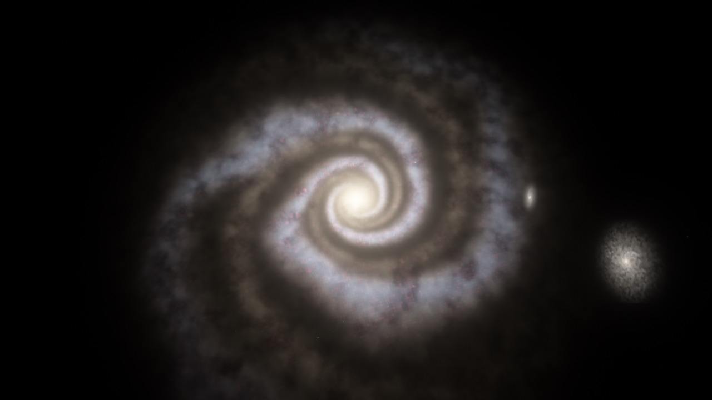

# Starhopper

**The universe, as code.** A real-time flight through the universe as we have actually mapped it, in your browser: from low Earth orbit, out past the planets, through 2.5 million real stars, and on to the galaxies of the cosmic web.


| | |
|---|---|
|  |  |

Rendered with WebGPU and no engine. Everything on screen is either a public catalogue or a documented procedural model; the only images are the surface maps of the Earth, the Moon and the planets. The brief it was built from is in [`prompt.txt`](prompt.txt).

## Flying

| | |
|---|---|
| `W A S D`, mouse | fly and look (click the view to capture the mouse) |
| `R` / `F`, `Q` / `E` | up / down, roll |
| scroll (two fingers on a trackpad), `Space` | the throttle, shown on a gauge at the right edge: it stays where you leave it, forward above the middle and back below; `Space` stops |
| `+` `-`, `Shift`, `Ctrl` | how fast `W` and `S` go: exponential, and it follows how close things are |
| click, then `G` | target what you are looking at, then fly to it |
| `1` to `8`, `0` | the fixed viewpoints, back to Earth (`Home` also works; on a Mac that is `Fn` + left arrow) |
| `L` `N` `X` | constellation figures, names, stars with known planets |
| `P` | hide all procedural fill: measured data only |
| `M`, `H`, `Tab`, `Esc` | sound, frame statistics, hide the panel, menu (and `Esc` again to resume) |

On a phone or tablet: drag the sky to look around; the strip on the right edge is the throttle (push up to fly forward, faster the further you push; pull down to back away; the top third is an overdrive that no longer slows for single stars, for crossing a galaxy in seconds; let go to stop; the Hold button below it keeps the speed so you can cruise hands-free). With two fingers, spread or pinch to fly and twist to roll. The ring at the bottom left is a stick for sliding sideways and up or down without turning (the keyboard's `A` `D` `R` `F`); it works together with a finger steering, so you can circle something while facing it; the target bar's Lock button (`O`) does the facing for you and holds the range, so the stick alone orbits the target. Tap something to target it: a bar at the bottom names it and offers "Fly there", a ring stays on it, and when it is out of view an arrow at the edge of the screen points the way back to it. Search lists matches as you type, forgiving a typo: pick one to target it, or its Fly button to go. Double tap to fly there at once, or long press for a go-to menu. During a fly-to the throttle strip sets the pace (up to hurry, down to hold still). Sound is on by default (`M` or the menu turns it off, and the menu has sliders for the overall volume and for the engine against the music): a drone and wind that follow your speed, under music composed as it plays, slow chords and occasional bells whose key follows the scale you are at. It is synthesised in the browser; nothing is downloaded. The menu has search, the viewpoints, named save points (kept in your browser), the detail level and the data credits.

## What is real and what is filled in

Measured, from catalogues pinned by checksum:

- **Stars**: AT-HYG 4.0, 2.53 million stars with distances (Hipparcos, Tycho-2, Gaia), magnitudes and colours.
- **Constellations and star names**: Stellarium's modern sky culture. The figures are drawn between the stars' real 3D positions, so they distort as you leave the Sun.
- **Sun, planets and Moon**: JPL's approximate Keplerian elements for the planets and the Astronomical Almanac's low-precision series for the Moon, at today's date. All at true size and distance, so from the Earth the planets are points of light: search for one by name to fly to it. A clock at the top runs them: real time by default, up to a year a second either way (`,` and `.`), pause (`T`), or back to now (`/`). The planets and Moon move along their orbits and turn at their true rates, and a camera near one is carried along with it. The orbit lines are drawn once, for the date the page opened.
- **Nebulae and clusters**: OpenNGC, with distances from Harris (globulars), Hunt & Reffert (Gaia clusters), Gaia-based planetary nebula and supernova remnant catalogues, molecular cloud distances and SIMBAD.
- **Galaxies**: GLADE 2.3 as points out to 268 Mpc; 10,900 OpenNGC and Local Volume galaxies with size, tilt and Hubble type, with distances from the Updated Nearby Galaxy Catalog and Cosmicflows-3 where they exist.
- **Exoplanet hosts**: NASA Exoplanet Archive, 4,520 stars.
- **Earth**: NASA Blue Marble Next Generation.
- **The Moon and the other planets**: Solar System Scope's maps (CC BY 4.0), assembled from NASA mission imagery: MESSENGER for Mercury, Viking for Mars, Cassini for Jupiter and Saturn, Voyager 2 for Uranus and Neptune, the Lunar Reconnaissance Orbiter for the Moon. Venus shows its cloud tops, which is an artist's map. Each body is turned to face the way the IAU's rotation model says it does today, so the Moon shows the Earth its near side; the giants' weather is from the day of the flyby. A map is fetched as you approach its body.

Flying fast draws the nearby stars and galaxies out into streaks along their path across the view, as an open shutter would; `V` turns that off.

The target bar's **i** button (`I`) opens a card about the target: what the catalogue itself says (kind, distances, size, light, and for the planets a few figures from NASA's fact sheets), then two or three sentences and a picture from Wikipedia where it has a page plainly about that object. The Wikipedia part is fetched from your browser when you open the card, is credited and linked there, and is not stored with the site; opening a card therefore tells Wikipedia which object you looked up.

Procedural, and hidden by `P`:

- The shapes of galaxies (spiral, elliptical or irregular from the catalogued type, size and tilt) and of nebulae.
- The Milky Way's diffuse light and dust, and individual "fill" stars where the catalogue is incomplete.
- Galaxies beyond the survey limit and behind the plane of the Milky Way: a statistical continuation of the web.
- The glow of the cosmic web: the survey's galaxies counted into a 128-cell density grid (4 Mpc cells, corrected for the survey thinning with distance) and drawn as faint light, megaparsecs from any galaxy.
- The Earth's clouds (the Blue Marble is a cloud-free mosaic), Saturn's ring detail, and fine grain on the Moon and rocky planets closer than their maps resolve.

Every source, with its licence and credit, is listed in the app under "Data and credits" and in the generated `data/manifest.json`.

## Running it

```sh
npm ci
npm run data        # fetch the pinned catalogues (about 240 MB into .cache, once) and bake ./data
npm test            # known objects are where the sky says they are
npm run build       # dist/index.html plus dist/data
npm run serve       # http://localhost:8080
```

`npm run build:dev` keeps the development hooks used by the tools:

- `node tools/capture.mjs [--fly]` renders the eight viewpoints (and frame pairs along the fly-through) in Chrome.
- `node tools/bench.mjs` runs the scripted 90 s fly-through in a visible Chrome at the display's native pixel size and prints frame-time and GPU-time statistics.
- `node tools/shot.mjs` renders any camera set-up.

Pushing to `main` builds, tests and deploys to GitHub Pages with no manual step.

The title screen names the build (commit and its date). GitHub Pages lets browsers keep the page for ten minutes, so the page also asks what is deployed and offers a newer build when there is one.

Every open pull request from a branch of this repository also gets a preview at `https://julienbonastre.github.io/starhopper/pr/<number>/`, linked from a comment on the pull request and marked with a red "Preview" badge. It is rebuilt a few minutes after each push and removed when the pull request closes. A preview that leaves `pipeline/` alone is only its page and reads the live site's data.

## Measured

On a MacBook Pro (M5 Pro, 20 GPU cores), Chrome 158, macOS 26.7, High detail, 3024 x 1964 at 120 Hz, resolution scale 1.0, over the scripted fly-through (`node tools/bench.mjs`, 2026-11-28):

| | average | 99th percentile | maximum |
|---|---|---|---|
| Frame interval | 8.33 ms | 10.3 ms | 10.5 ms |
| GPU time per frame | 4.11 ms | 6.18 ms | 10.11 ms |

- No frame was presented late (0 of 10,848).
- One GPU sample of 10,257 exceeded 8.3 ms (it comes and goes between runs, at the instant the last leg starts, and never delays a frame).
- JS heap at the end of the run: 39 MB.

Sizes:

- `index.html` is 101 kB (37 kB gzipped) and holds all the code.
- Needed before the first frame: the page, the star and galaxy indexes, the detailed galaxies and the first star tile, about 0.9 MB.
- Streamed afterwards as you fly: star tiles 42 MB in 1,797 files (the view from Earth uses about 14 MB of them), galaxy tiles 5.6 MB, names, nebulae and exoplanet hosts 0.6 MB, the Earth image 2.3 MB, the Moon and planet maps 3.9 MB in 8 files (each fetched on the way to its body), the galaxy density grid 0.8 MB.

## Not done, or not verified

- **Relief on the Moon and planets**: the maps are colour only. Craters and mountains do not cast shadows at the day/night line; that needs the laser-altimeter elevation maps (LOLA, MOLA), which are not in yet.
- **Phones**: the touch controls, landscape lock, detail levels and Save-Data handling are written but have not been run on a phone. The Galaxy S23 Ultra performance target is unmeasured.
- **Visual review**: four rounds with an independent critic that sees only the renders have not reached the brief's "nothing above minor". Round four (after the nebulae were remodelled as cavities with ionisation fronts and the Milky Way's streaks were removed) found one blocker, the Pleiades drawn in red emission, which is fixed: their dust now shines blue by reflection. Its majors that remain open: the Milky Way's band from inside reads as grey smoke without grain; the inside of the Orion nebula is soft with gritty edges; the Milky Way from above is a clean two-arm pinwheel with no bar; Andromeda's inner and outer disc disagree; the Sun at 70 AU is a disc in a halo. The cosmic web has since gained a density glow, not yet re-reviewed. Nothing pops between frames.
- **Redshift distances** stretch galaxy clusters along the line of sight from Earth ("fingers of God"). This is in the data and is left as it is.
- **M32** sits 280 kpc from Andromeda because the Local Volume catalogue lists it at 0.49 Mpc.
- **Live-database snapshots**: the NASA Exoplanet Archive and SIMBAD have no versioned releases, so the exact query results fetched on 2026-11-27 are kept in `pipeline/snapshots` (0.6 MB) and checked against their checksums like every other source. The build does not query either database; `pipeline/lib.mjs` says how to refresh them.
- **Nebula distances by association**: about 100 of the 1,198 nebulae have no measured distance of their own and take that of the cluster inside them or the nearest molecular cloud sightline. Some are wrong (the Pencil Nebula lands at 1,962 pc; it is about 250 pc). They are not flagged in the app.
- **Names** are the first common name OpenNGC gives, so M 11 is "Amas de l'Ecu de Sobieski" and the Tarantula is "30 Dor Cluster"; search by Messier or NGC number always works.
- **Earth image**: 5400 x 2700, larger than "modest"; no smaller Blue Marble is still served at a fixed address. Phones decode it at 2048 x 1024.
- **Planets**: no moons but our own, no rotation or axial tilts, and nothing moves while you watch; valid for 1800 to 2050. The Moon's seas are a stand-in pattern, not a map.
- **Sharing a view** (image plus a link carrying position and heading) is on the backlog.

Inspired by [Abyssal Garden](https://github.com/Noniv/abyssal-garden).

## License

Code is [MIT](LICENSE). Baked catalogue data carries the licences of its sources (AT-HYG, Stellarium and OpenNGC are CC BY-SA 4.0; the Moon and planet maps are CC BY 4.0), listed in the app's credits.
